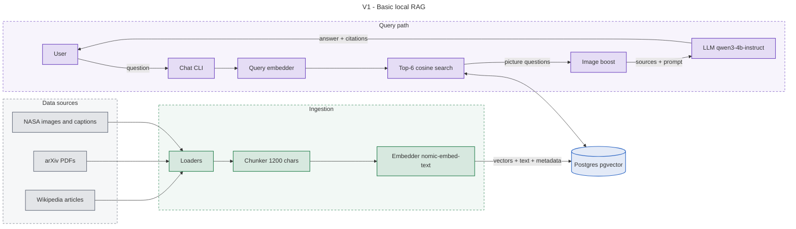
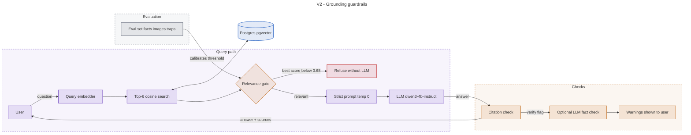
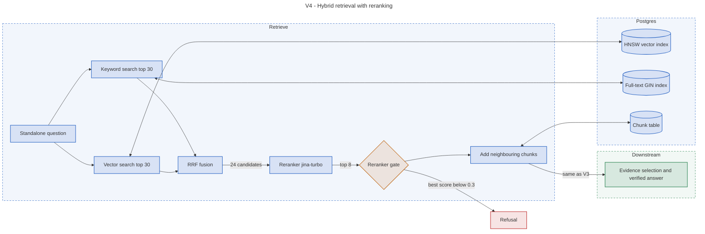
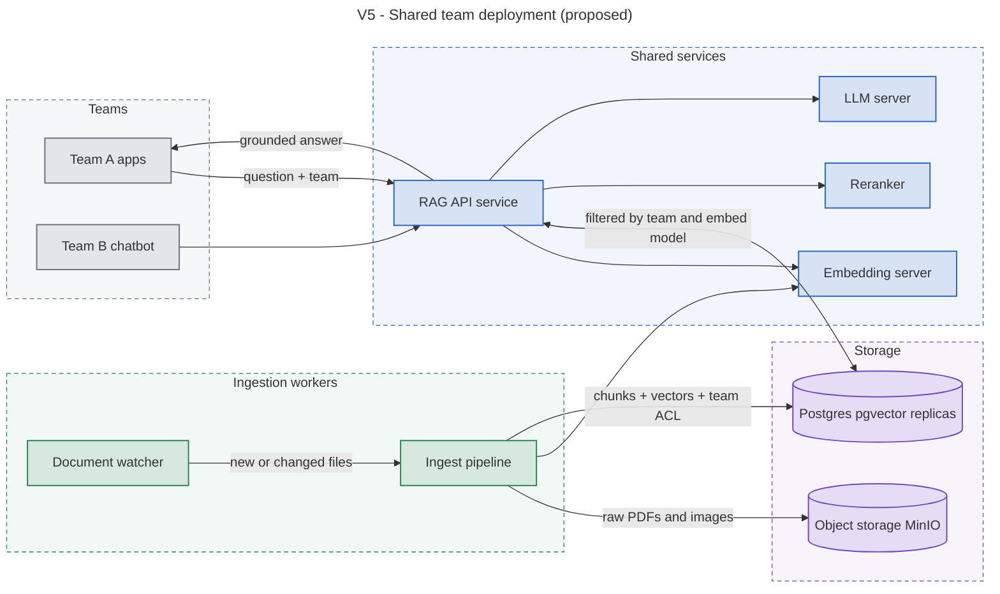

# Architecture diagrams

Eraser.io diagram-as-code, one file per version. In eraser.io: new diagram → Flow chart → open the code panel → paste.

**Mermaid:** `scripts/eraser_to_mermaid.py` converts each `.eraser` file to a `.mmd` Mermaid flowchart, refreshes the diagrams below (GitHub renders them), and embeds both into the viewer. Run it after editing a diagram.

**Interactive viewer:** `viewer.html` renders the Mermaid diagrams with Mermaid 11 + the ELK layout (as in codesm's docs): version tabs, pan/zoom, ELK/Dagre and direction toggles, click a box to trace its inputs and outputs, components new since the previous version highlighted, live-editable Mermaid code. Open it in a browser.

| Source | Version |
|---|---|
| `v1-basic-rag.eraser` | V1 basic RAG |
| `v2-grounding-guardrails.eraser` | V2 relevance gate and checks |
| `v3-evidence-first.eraser` | V3 evidence by sentence ID, answer from quotes, removal |
| `v4-hybrid-retrieval.eraser` | V4 vector + keyword, fusion, reranker, neighbours |
| `v5-team-deployment.eraser` | V5 proposed shared deployment |

What changed between versions and why: [../versions.md](../versions.md).

## Diagrams

<!-- mermaid:begin -->
### V1 - Basic local RAG

### V2 - Grounding guardrails

### V3 - Evidence-first answering

```mermaid
---
title: V3 - Evidence-first answering
---
flowchart LR
  n0[("Postgres pgvector")]
  subgraph g1["Understand"]
    n2["User"]
    n3["Chat history"]
    n4["Follow-up rewriter"]
  end
  subgraph g5["Retrieve"]
    n6["Top-6 cosine search"]
    n7{"Relevance gate"}
  end
  subgraph g8["Evidence"]
    n9["Sentence numbering"]
    n10["LLM selects sentence IDs"]
    n11["Code looks up exact sentences"]
  end
  subgraph g12["Answer"]
    n13["LLM answers from quotes only"]
  end
  subgraph g14["Verify"]
    n15["Citation check"]
    n16["Batch LLM fact check"]
    n17["Remove unsupported sentences"]
  end
  n18["Refusal"]
  n2 -->|"question"| n4
  n3 --> n4
  n4 -->|"standalone question"| n6
  n6 <--> n0
  n6 --> n7
  n7 -->|"nothing relevant"| n18
  n7 --> n9
  n9 --> n10
  n10 -->|"IDs like 2.5"| n11
  n11 -->|"no valid evidence"| n18
  n11 -->|"verified quotes"| n13
  n13 --> n15
  n15 --> n16
  n16 --> n17
  n17 -->|"nothing supported left"| n18
  n17 -->|"answer + evidence + sources"| n2
  classDef gray fill:#6b728022,stroke:#6b7280,stroke-width:1.5px
  classDef green fill:#2b835222,stroke:#2b8352,stroke-width:1.5px
  classDef blue fill:#2c66c422,stroke:#2c66c4,stroke-width:1.5px
  classDef purple fill:#7148c022,stroke:#7148c0,stroke-width:1.5px
  classDef orange fill:#bf671622,stroke:#bf6716,stroke-width:1.5px
  classDef red fill:#c2343422,stroke:#c23434,stroke-width:1.5px
  class n0,n6 blue
  class n2,n3,n4,n13 purple
  class n7,n15,n16,n17 orange
  class n9,n10,n11 green
  class n18 red
  style g1 fill:#7148c00f,stroke:#7148c0,stroke-dasharray:5 4
  style g5 fill:#2c66c40f,stroke:#2c66c4,stroke-dasharray:5 4
  style g8 fill:#2b83520f,stroke:#2b8352,stroke-dasharray:5 4
  style g12 fill:#7148c00f,stroke:#7148c0,stroke-dasharray:5 4
  style g14 fill:#bf67160f,stroke:#bf6716,stroke-dasharray:5 4
```

### V4 - Hybrid retrieval with reranking

### V5 - Shared team deployment (proposed)

<!-- mermaid:end -->
